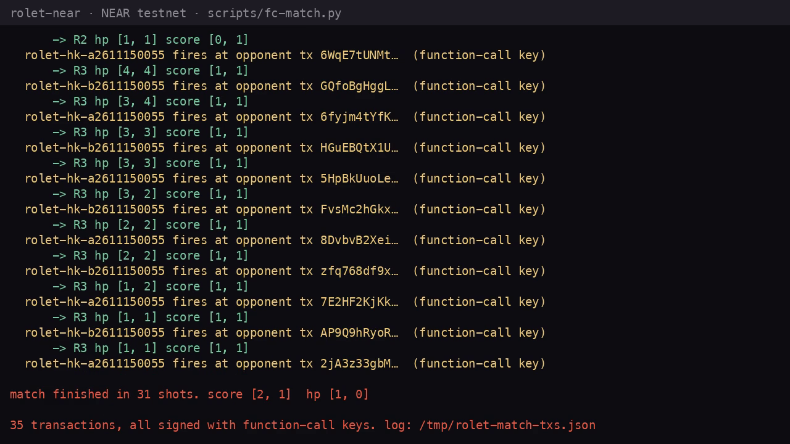

# Rolet NEAR

**A turn-based revolver duel whose match rules run in a NEAR smart contract.**

Two players share one revolver. The contract loads 8 chambers with a random 2–6 live rounds and announces the live count at every load. Each player starts with 4 HP. On your turn you either play an item card or pull the trigger: aim at your opponent, or aim at yourself (a blank on yourself keeps your turn). First to 0 HP loses a round; a match is best of 3 rounds. The winner is paid a reward from the contract's treasury.

Rolet started as a Solana/MagicBlock game. **This repository is its port to NEAR, built during NEAR HACKATHON 2026.**

---

## NEAR HACKATHON 2026 submission: what was built here

**Disclosure (port of an existing project).** Rolet was first written for Solana with Anchor and a MagicBlock ephemeral rollup. That earlier work ends at commit `d78452f` (26 Oct 2026) and is tagged **`pre-hackathon`**. It is baseline and is **not** part of this submission.

Everything after that tag is the NEAR work done during the hackathon (14 Nov 2026 UTC; commit times in the log are UTC+3) and is what should be judged:

- **Hackathon diff:** https://github.com/SmtDcs/rolet-near/compare/pre-hackathon...hackathon-submission
- Tags: `pre-hackathon` = baseline, `hackathon-submission` = the submitted commit.

What the hackathon work contains:

1. **`contracts/rolet-near/`, a new NEAR contract (Rust, `near-sdk` 5.30.2).** It was written from scratch and is not a translation of the Anchor program. It contains:
   - **Match rules on chain** (`src/game.rs`, `src/matches.rs`): loads, firing at yourself or the opponent, 9 item cards, HP, 3-round matches, turn and reveal timeouts (`claim_timeout`).
   - **Commit-reveal randomness** (`src/rng.rs`): each player commits `sha256(secret ‖ account_id ‖ match_id_le)` in `join`, then reveals. Every random draw is `sha256(match_seed ‖ draw_nonce ‖ env::random_seed())`, so neither player nor the block producer alone picks the seed.
   - **A shared deck**: 9 item types × 4 copies (`copies_per_item: 4`). Hands hold up to 4 cards (`max_items: 4`).
   - **Character NFT as entry ticket** (`src/nft.rs`): `buy_character` mints a NEP-171 token (price 1 NEAR in `init-config.json`). The standard `nft_*` methods come from `near-contract-standards`.
   - **Leaderboard and player stats**: the `leaderboard`, `get_player` and `get_character` views.
   - **Treasury** (`src/treasury.rs`, `src/nft.rs`): character sales are split 5% ops / 95% treasury. When a match ends, the contract transfers the winner's reward (0.1 NEAR by default) from the treasury. If the treasury is short, the reward is recorded as owed and the winner can collect it later with `claim_reward`.
   - **NEP-297 events** for every game action (`src/events.rs`, `EVENT_JSON:` logs), plus the `get_actions` view so the client can replay a match.
   - Owner controls (`set_config`, `pause`/`unpause`, `migrate`) and storage accounting covered by tests.
2. **Walletless turns with a function-call access key** (`apps/web/lib/nearKey*.ts`, `nearCall.ts`, `nearKeyFlow.ts`). The player signs in once with MyNearWallet or Meteor (`@near-wallet-selector` 10.1.4). The dApp gets a function-call key limited to the Rolet contract, and each turn is signed with that key in the browser, with no wallet pop-up per move. A dev-only page at `/dev/near-key` exercises this flow.
3. **TypeScript game engine with contract parity** (`apps/web/lib/game/`). This includes rules, a redacted per-player model, an action-log sync, an intent state machine, aim gestures, a bot and a wallet-free practice engine. `contracts/rolet-near/tests/vectors_export.rs` exports test vectors from the Rust contract into `docs/near/schema/vectors.json`, and `lib/game/vectors.test.ts` checks that the TS rules match the contract exactly.
4. **Testnet scripts**: `contracts/rolet-near/scripts/deploy-testnet.sh` (build, deploy, fund), `cli-match.sh` (a two-account match with full-access keys) and `fc-match.py` (a full match where every turn is signed with a function-call key). All of them refuse anything that is not `testnet`.
5. **NEAR web app** (`apps/web/app/duel`, `profile`, `leaderboard`, `api/rpc`, `api/matchmaking`, `api/stats`; `lib/duelFlow.ts`, `lib/game/nearTransport.ts`, `actionPoller.ts`, `clock.ts`; `hooks/useRoletNear.ts`; `components/NearProvider.tsx`). A wallet-selector provider, an RPC proxy, symmetric matchmaking with NEP-413 signed queue entries, a duel state machine, an action poller that turns contract actions into scene beats, and a turn clock with a timeout-claim button.

### Status (at submission time)

- ✅ The contract is complete and tested (unit tests + `near-workspaces` sandbox integration tests).
- ✅ The NEAR client libraries, the function-call key flow and the TS game engine are implemented and tested.
- ✅ **Deployed on testnet** as `rolet.rolet-hk-o2611150055.testnet`, and a full match was played on it with function-call keys only. See "Live on NEAR testnet" below.
- ✅ A wallet-free practice match against a bot is playable at `/practice` (2.5D table, 3D revolver, drag-to-aim).
- ✅ **On-chain duels at `/duel`** against the deployed testnet contract: connect a NEAR testnet wallet, mint a character, get matched, commit-reveal, then play every turn in the same scene with a function-call key (no wallet pop-up per move). `/profile` (characters, rewards) and `/leaderboard` read and write the same contract. The Solana-era code was removed from `apps/web`.

---

## Live on NEAR testnet

Contract: [`rolet.rolet-hk-o2611150055.testnet`](https://testnet.nearblocks.io/address/rolet.rolet-hk-o2611150055.testnet). It was built from `contracts/rolet-near` in this repository and initialised with `init-config.json`.

On 2026-11-14 (UTC), two fresh testnet accounts played one full match against it (match id `1794693498`, player A won 2–1). Every game transaction (`join`, `reveal`, all 31 `fire` calls) was signed with a **function-call access key** that can only call the Rolet contract. No full-access key was used during play.

| Step | Transaction |
|---|---|
| Deploy + `new(owner, config)` | [4b2GeVjm…](https://testnet.nearblocks.io/txns/4b2GeVjmGHdKEPiZVhnCx1JwSigUG8GponZrnoJ2Zsdm) |
| `fund_treasury` (2 NEAR) | [BppG5rLC…](https://testnet.nearblocks.io/txns/BppG5rLCuuQSpzxZbwhAfke7dRGitAXPZv2N97ukkjE1) |
| Player A `buy_character` (NEP-171 mint, 1 NEAR) | [gvGMiTx9…](https://testnet.nearblocks.io/txns/gvGMiTx9agLU8DTDJijGt8mfhhzsSd4N3Ge8HWFpqfA) |
| Player A adds a function-call key (0.5 NEAR allowance, Rolet methods only) | [E5mHxpTL…](https://testnet.nearblocks.io/txns/E5mHxpTLCVJYkfQxx1vWBABpPUbQjRswmuuEkhUV62VF) |
| Player B `buy_character` | [E91Q7eHm…](https://testnet.nearblocks.io/txns/E91Q7eHmNkGBY4PWQyNCANQEqdiv8JrgbUfDuBfEMhG4) |
| Player B adds a function-call key | [DmZHjVbz…](https://testnet.nearblocks.io/txns/DmZHjVbzNMyJUaLLtAbysHC5HZigbhLoFLBgPhRYSi2e) |
| A `join` (commit) | [8AA5ZG8V…](https://testnet.nearblocks.io/txns/8AA5ZG8V9QaavPvHA8ogaizj3Zf2PaTL388m4ZnqJXNW) |
| B `join` (commit) | [CVJMx4dg…](https://testnet.nearblocks.io/txns/CVJMx4dg82HNK1c2AF3AHu8Xv9kK2bDcF98a1xpeTfp4) |
| A `reveal` | [2RPaHDpX…](https://testnet.nearblocks.io/txns/2RPaHDpXb22uQXPx7DcFbUvks1iwsMG5ZTdkPMFXm1Lp) |
| B `reveal` → match active | [He9iUmM1…](https://testnet.nearblocks.io/txns/He9iUmM1yhCJYVfFFUiwM8uH3jFPopUtKGkJLcqv6Tvq) |
| First `fire` | [H3j5iv3e…](https://testnet.nearblocks.io/txns/H3j5iv3epJEvD9Htboq4qvJJR8Qk4EqEwbgEqdBNywkA) |
| Last `fire`: `RoundEnded` 2–1, `MatchEnded`, 0.1 NEAR reward sent to A | [2jA3z33g…](https://testnet.nearblocks.io/txns/2jA3z33gbMfQVKfp31V9uo9ESPybdVB8FDUPWyzyUST2) |

All 35 match transactions are listed in [docs/near/testnet-match-txs.json](docs/near/testnet-match-txs.json).



### Check it yourself (read-only, no account needed)

```bash
# do: read the config the contract was initialised with
near contract call-function as-read-only rolet.rolet-hk-o2611150055.testnet get_config json-args '{}' network-config testnet now
# see: load_size 8, min_live 2, max_live 6, max_items 4, copies_per_item 4, rounds with start_hp 4

# do: read the finished match
near contract call-function as-read-only rolet.rolet-hk-o2611150055.testnet get_match json-args '{"match_id":"1794693498"}' network-config testnet now
# see: "status": "Finished", score [2, 1]

# do: read the leaderboard
near contract call-function as-read-only rolet.rolet-hk-o2611150055.testnet leaderboard json-args '{}' network-config testnet now
# see: player A with wins 1, player B with losses 1
```

### Play a match yourself against the deployed contract

You need two funded testnet accounts in the near-cli-rs legacy keychain (`~/.near-credentials`). The faucet works: `near account create-account sponsor-by-faucet-service <name>.testnet autogenerate-new-keypair save-to-legacy-keychain network-config testnet create`.

```bash
C=rolet.rolet-hk-o2611150055.testnet
# 1. each player mints a character NFT (entry ticket, 1 NEAR)
near contract call-function as-transaction $C buy_character json-args '{"kind":"Kuleci"}' prepaid-gas '30.0 Tgas' attached-deposit '1 NEAR' sign-as <A>.testnet network-config testnet sign-with-legacy-keychain send
near contract call-function as-transaction $C buy_character json-args '{"kind":"Ayarci"}' prepaid-gas '30.0 Tgas' attached-deposit '1 NEAR' sign-as <B>.testnet network-config testnet sign-with-legacy-keychain send
# 2. each player adds a function-call key limited to the game methods
near account add-key <A>.testnet grant-function-call-access --allowance '0.5 NEAR' --contract-account-id $C --function-names 'join,reveal,cancel,fire,use_item,claim_timeout' autogenerate-new-keypair save-to-legacy-keychain network-config testnet sign-with-legacy-keychain send
#    (same for <B>; the key file is saved as ~/.near-credentials/testnet/<account>/ed25519_<pubkey>.json)
# 3. play a full match with those keys only
cd contracts/rolet-near
ROLET_CONTRACT_ID=$C PLAYER_A=<A>.testnet PLAYER_B=<B>.testnet \
FC_KEY_A=~/.near-credentials/testnet/<A>.testnet/ed25519_<pubkeyA>.json \
FC_KEY_B=~/.near-credentials/testnet/<B>.testnet/ed25519_<pubkeyB>.json \
python3 scripts/fc-match.py
# see: join/reveal/fire lines with tx hashes marked "(function-call key)", then
#      "match finished in N shots. score [2, x]". The winner receives 0.1 NEAR from the treasury.
```

---

## Quick start (reproduce the results)

Requirements: Rust (stable, 1.96 tested), `cargo-near` 0.23.0, Node 20+, pnpm 10.33.2. `docs/near/VERSIONS.md` lists every pinned version.

### 1. Build the contract WASM

```bash
cd contracts/rolet-near
cargo near build non-reproducible-wasm --no-abi
# output: target/near/rolet_near.wasm
```

Result on the submitted commit: build succeeds, `rolet_near.wasm` is about 342 KB.

### 2. Contract tests (unit + near-workspaces sandbox)

```bash
cd contracts/rolet-near
cargo test
```

The integration tests deploy `target/near/rolet_near.wasm` into a local NEAR sandbox, so build the WASM first (step 1). Result on the submitted commit: 136 unit tests and 9 sandbox integration tests pass (a full match, the function-call key flow, timeouts, gas floors, a full 100-entry leaderboard, NFT transfer refunds). `vectors_export` is `#[ignore]`d; it only regenerates `docs/near/schema/vectors.json`.

### 3. Web client tests (rules, contract parity, key flow)

```bash
pnpm install
pnpm --filter web test
pnpm --filter web exec tsc --noEmit
```

Result on the submitted commit: `117` tests, `117` passed, `0` failed. `tsc --noEmit` exits `0`.

### 4. Deploy your own copy to testnet (optional, needs funded testnet accounts)

```bash
cd contracts/rolet-near
# preview, touches nothing on chain
ROLET_CONTRACT_ID=rolet.<you>.testnet ROLET_OWNER_ID=<you>.testnet ./scripts/deploy-testnet.sh --dry-run
# real deploy: build, deploy with init-config.json values, fund the treasury, check get_config
ROLET_CONTRACT_ID=rolet.<you>.testnet ROLET_OWNER_ID=<you>.testnet ./scripts/deploy-testnet.sh

# full match between two testnet accounts
ROLET_CONTRACT_ID=rolet.<you>.testnet PLAYER_A=alice.<you>.testnet PLAYER_B=bob.<you>.testnet ./scripts/cli-match.sh
```

After the deploy, `get_config` should return `load_size: 8`, `min_live: 2`, `max_live: 6`, `max_items: 4`. A finished CLI match logs a `MatchEnded` NEP-297 event, and the winner receives the 0.1 NEAR reward.

### 5. Play locally (no wallet)

```bash
pnpm install
pnpm --filter web dev
# open http://localhost:3000/practice
```

You play a full match against a bot. The bot uses the same TypeScript rules engine that is checked against the contract. Click the revolver and drag **up** to shoot the rival or **down** to shoot yourself (a blank on yourself keeps your turn). Click an item on the table to use it.

### 6. Try the function-call key flow in the browser

Put the deployed contract ID in `apps/web/.env.local` as `NEXT_PUBLIC_NEAR_NETWORK=testnet` and `NEXT_PUBLIC_ROLET_CONTRACT=...`, run `pnpm --filter web dev`, and open http://localhost:3000/dev/near-key. Sign in with MyNearWallet or Meteor, and the page signs `join` and `fire` with the function-call key.

---

### 7. Play an on-chain duel (NEAR testnet wallet)

```bash
pnpm --filter web dev
# open http://localhost:3000/duel in two browsers (two testnet accounts)
```

The app defaults to `NEXT_PUBLIC_NEAR_NETWORK=testnet` and `NEXT_PUBLIC_ROLET_CONTRACT=rolet.rolet-hk-o2611150055.testnet` (see `apps/web/.env.example`). Sign in with MyNearWallet or Meteor on testnet, buy a character (1 testnet NEAR), approve the game key once, then join the match queue in both browsers. Testnet only, no real money.

## Game values (`contracts/rolet-near/init-config.json`)

| Value | Setting |
|---|---|
| HP per round | 4 |
| Revolver | 8 chambers, 2–6 live rounds at random, live count announced at load |
| Rounds | best of 3 (heal cut at 2 HP in the last round) |
| Hand | up to 4 item cards, 4 dealt per load |
| Deck | shared, 9 item types × 4 copies |
| Items | Loupe, Pipe, Flask, Shackle, Hacksaw, Ticker, Magnet, Lockpick, Tincture |
| Character NFT price | 1 NEAR |
| Winner reward | 0.1 NEAR from the treasury |
| Turn / reveal timeout | 45 s / 60 s |

## Repository layout

```
contracts/rolet-near/   NEAR contract (Rust, near-sdk) + tests + testnet scripts   [hackathon]
apps/web/lib/near*.ts   NEAR client: RPC, wallet selector, function-call key, calls  [hackathon]
apps/web/lib/game/      TS rules engine, contract parity, practice mode, bot         [hackathon]
apps/web/lib/stage/     scene <-> game protocol for the 2.5D scene                   [hackathon]
docs/near/              design, plans, audits and reports (dev notes, mostly in Turkish) [hackathon]
apps/web/ (rest), packages/, godot/   Solana-era client, shared package, Godot prototype [baseline]
docs/solana-README.md   the original Solana README                                   [baseline]
```

## Libraries

- Contract: `near-sdk` 5.30.2, `near-contract-standards` 5.30.2, `borsh`. Tests use `near-workspaces` 0.24.0, `tokio` and `sha2`.
- Client: `@near-js/*` 2.5.1 (accounts, crypto, providers, signers, transactions), `@near-wallet-selector/*` 10.1.4 (MyNearWallet, Meteor), `@noble/hashes`, Next.js 16, React 19, `three` / `@react-three/fiber` / `@react-three/drei`, `gsap`, `tsx` for tests.
- The 3D revolver model was generated with Meshy.

## How this was built (AI disclosure)

Built with AI coding assistants (Claude Code, Gemini via Antigravity, Command Code) under my direction. I wrote the design, rules and task plans (`docs/near/DESIGN.md`, `TASKS.md`, `PLAN-*.md`). Most of the code was written by those assistants and checked through audit and fix rounds (`docs/near/AUDIT-*.md`, `FIX-*-REPORT.md`) and the test suites above.

## Other project by the same builder

I am also submitting **[Bondline](https://github.com/SmtDcs/Bondline)** to NEAR HACKATHON, a separate and independent project. It makes refund promises from AI support bots binding: each bot reply is signed inside a NEAR AI TEE, and a NEAR contract pays the customer from the shop's locked bond, up to a cap the shop chose.

## License

MIT. See [LICENSE](LICENSE).
